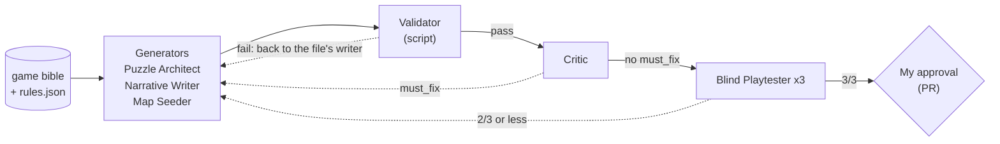

# Assignment #6: Style Guide Agent

The goal: an automated, self-correcting loop (Generator → Evaluator → Refiner) that enforces my game's own aesthetic and narrative rules. Most of this already existed in the content pipeline I built for Assignments 3 and 4. This section maps that pipeline onto the loop, then covers the part that's still missing: art. 
  
Maybe it's the style/game type I chose. Part of me feels like I don't trust AI enough to just run over night but also since narrative and art are things that need a human touch to it, I can't fully let it run loose and do it's own thing while I grab a coffee.  

## The Gap: The Art Loop
When I originally tried to check for gaps in the self-correcting AI loop, Claude mentioned theres a gap for art loop. The art side has a generator and a refiner but **no automated evaluator: I'm the evaluator.** I tried to create an agent that would generate the post-meal outcome graphics but since I was using the free version of Nano Banana 2, Claude said I would have to paste in the prompts on my own. I asked Claude to generate prompts and an art artifact dashboard to at least help me visually manage the assets. I set up an art generator agent to connect to pixellab to generate icons/badges but this also ended up at a deadend when I hit token limit. So I ended up using the ones that were generated as samples back in Nano Banana 2. It was definitely a tedious process though and sometimes the LLMs would drift and images wouldn't make sense. Ultimately, I still wanted a say in the graphics and prefered to have non-ai art but I am just 1 person so I don't plan to send this task to the agent.

## The style guide

The style guide is the game bible (`docs/game_bible.md`), and it's the single source of truth. Every agent reads it before writing anything. The rules a script can check are copied into `scripts/rules.json`:

- **Narrative rules:** each character's voice and permanent needs (Cyrus's peanut allergy, Mina's vegetarianism), the clue vocabulary, how deep a clue may be buried, the districts and their venues, and the callbacks between levels. Sometimes the agents would drift and become repetitive and I would start to add more rules to the writer, map seeder to check for freshness. When I went back to proofreading and editing, sometimes the dialogue would sound really naggy. Then I would update the agents again to check for that as well. 
- **Aesthetic rules:** cozy pixel art, soft outlines, a warm palette, file names and sizes. The palette was the one Open item, so I locked it on 2026-11-20: **Cozy Ramps 32**, 32 colours in 9 shading ramps, picked from five options tested against my existing art. It's now in the bible and in `rules.json` as `art.palette`.

## The self-correcting loop that already exists

Each level goes through three loops, one inside the next. A failure goes back to the agent that wrote the failing file, never to the whole crew. Each agent gets at most 3 retries per level; after that the level is flagged for me.

| Loop | Generator | Evaluator | Refiner (where a failure goes) | Done when |
| --- | --- | --- | --- | --- |
| **1. Rules** | Puzzle Architect (spec), Narrative Writer (chat, outcomes), Map Seeder (venues) | `validate.js`, a script that checks every file against `rules.json`. Same input, same result, no AI. | The agent the validation log names as the file's writer | The Validator passes |
| **2. Quality** | The same agents | The Critic agent: voice, clue fairness, chat vs. reviews, telling venue names, repetition. It never edits. | Each `must_fix` goes to the file's writer. In the first round, suggestions go too. Every fix re-runs loop 1 first. | No `must_fix` left |
| **3. Playability** | The finished level | 3 separate Blind Playtester runs. They see only what a player sees: no spec, no outcomes, and from level 03 no clue tags. | 2/3 correct: the Narrative Writer strengthens the weakest clue. 0–1/3: the Writer if a clue is buried, the Puzzle Architect if the puzzle is unsound. | 3/3 correct, every constraint found |

What makes it strict and not just "try again":

- **Rules come from one place.** The Validator reads `rules.json`, which is copied from the bible, so a narrative rule is enforced by code, not by an agent remembering it.
- **Evaluators can't see the answers.** The Critic can't edit, and the Playtester never sees the spec or outcomes, so a pass means a real player could solve it.
- **Every step is logged.** `logs/run_log.json` has 570 logged steps across all 20 levels, 73 of them retries. Provenance records each agent commit's hash, so every fix can be traced.
- **I approve last.** No level reaches `master` without my approval on its PR.

### Two corrections from the logs

- **Level 03, playability loop.** All 3 playtesters picked the right venue, but all 3 also said Mina's vegetarianism was *stated*, while the bible says her needs only show as hints. The level went back to the Narrative Writer (retry 1), which rewrote line 11 so the need was implied. It passed the Validator again, and the retest came back 3/3 with "vegetarian inferred from hints".
- **Level 12, quality loop.** The Critic raised a `must_fix`: Mina's vegetarian clue only echoed the answer's review, so it didn't rule out the decoys. It went to the Narrative Writer, which made the clue about the whole Viet row. The Critic then passed it with 0 must-fixes and 3/3 playtests.

Across the campaign, the Critic caught `must_fix` problems on levels 02, 12, 13, 16 and 17: continuity errors against earlier levels, a clue that pointed at only one venue, a need stated where the bible says it should be implied, and weak dairy-free evidence for one venue. Levels 12–17 were fixed and re-checked inside the loop before I saw them. Level 02's came from an audit after approval, and I fixed it by hand.
